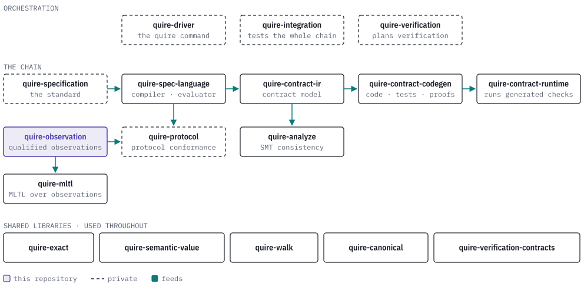

# quire-observation

[](https://discord.gg/k8DVhuYBR2)

A rule about a running system, such as *every order that ships was paid for
first*, is only as good as the data it is checked against. A raw signal says
that something was seen; it does not say which source saw it, under which schema,
about which object, on which clock, inside which window, or whether the list of
things you were supposed to see is complete. quire-observation is a Rust library
that turns a raw signal into a **qualified observation** by checking every one of
those selections, and it does so independent of how the signal travelled.

It exists so the layer above never has to guess. A checker that reads an absent
value as "false" reports violations that never happened. Here, a missing value, a
missing population member or a missing relationship comes back as `Incomplete`
and names what is missing. A selection that does not match, such as the wrong
unit, a foreign clock or an exceeded limit, comes back as `Refused` with a typed
cause. Only a fully qualified set comes back as `Available`.

<picture>
  <source media="(prefers-color-scheme: dark)" srcset="docs/images/hero-dark.svg">
  
</picture>

> **Status: public prerelease.** The API is still changing and the crate is not
> published (`publish = false`). Expect breaking changes.

## What a record carries

Each candidate record names everything it depends on, and admission compares each
name with the selection the caller made. Event time and ingestion time are kept
apart, and a timestamp never stands in for a causal relationship: relationships
must be supplied explicitly.

<picture>
  <source media="(prefers-color-scheme: dark)" srcset="docs/images/record-dark.svg">
  
</picture>

## A first admission

`admit` takes one `AdmissionRequest` (the package, producer bundle, binding,
expected subject, relationships, scope, records and resource limits) and returns
an `AdmissionOutcome`. These two tests from
[`tests/admission.rs`](tests/admission.rs) show the first two outcomes; the
`request()` helper in that file builds a complete, valid request.

```rust
// A valid record is admitted and every selected premise is retained.
let outcome = admit(request());
assert!(matches!(outcome, AdmissionOutcome::Available { observation }
    if observation.records()[0].visibility == Visibility::External
        && observation.package().identity == id("package:checkout")
        && observation.limits().max_records == 2));

// The same request with no value is incomplete, not false.
let mut input = request();
input.records[0].value = ValueState::Missing;
assert!(matches!(admit(input), AdmissionOutcome::Incomplete { reasons }
    if matches!(reasons.as_slice(), [IncompleteReason::MissingValuation { .. }])));
```

## Outcomes

No outcome is a Boolean truth value.

| Outcome | Meaning |
| --- | --- |
| `Available` | Every required premise was admitted. The `QualifiedObservation` keeps the package, producer, binding, subject, relationships, scope, records and limits exactly as selected. |
| `Incomplete` | A required premise is absent: `MissingValuation`, `MissingMembership`, `MissingRelationship` or `MissingClosure`. |
| `Refused` | A selection is invalid or does not match. `RefusalCause` says which: a binding, subject or clock mismatch, an invalid window, an exceeded limit, a duplicate record or member, an ambiguous or conflicting relationship, or an identity that differs from the one derived by the owner contract. |

## Owner contracts

Beyond admission, the crate publishes fourteen canonical, bounded owner
contracts for activation scope, observation records, populations, position
ledgers, clocks, partial facts, capture environments, progress, closure,
completeness, result availability, revisioned bundles and bounded lineage. Each
has a JSON Schema in [`schemas/`](schemas/) and a module under `authority::`
whose reader returns only a strict-read, validated view. The full table of
contract names, schema digests and readers is in
[docs/owner-contracts.md](docs/owner-contracts.md).

## What it does not do

The library has no telemetry adapter, temporal evaluator or protocol-result
mapper. It does not execute production monitors, interpret protocol conformance
or own an evidence store. The Producer interface 1.2 static bundle it admits
(`StaticProducerBundle`, `AdmittedStaticBundle` in `src/producer.rs`) is
validated by this crate's own code, and a test fixture of that shape lives in
[`tests/fixtures/`](tests/fixtures/).

## The Quire ecosystem

<picture>
  <source media="(prefers-color-scheme: dark)" srcset="docs/images/ecosystem-dark.svg">
  
</picture>

quire-observation is a foundation. It depends on
[quire-canonical](https://github.com/agent-ix/quire-canonical) for canonical JSON
and on no other Quire repository. Later temporal and protocol checks are its
intended consumers; they take an `Available` observation as the data a rule is
evaluated over, and this crate does not depend on them.

## Building and testing

The repository's own gate, from [AGENTS.md](AGENTS.md):

```sh
cargo fmt --check
cargo clippy --locked --all-targets -- -D warnings
cargo test --locked
RUSTDOCFLAGS="-D warnings" cargo doc --locked --no-deps
```

Hosted CI runs only when dispatched by hand, so run the gate locally before
opening a pull request. The requirements, test cases and reviews are Markdown
files under [`spec/`](spec/) and [`reviews/`](reviews/); tests are tagged with
the criteria they check.

## Contributing and licence

Contributions need the [CLA](CLA.md); see [CONTRIBUTING.md](CONTRIBUTING.md) and
[AGENTS.md](AGENTS.md). Questions are welcome on
[Discord](https://discord.gg/k8DVhuYBR2). Licensed under
[AGPL-3.0-or-later](LICENSE); see [LICENSE-DECISION.md](LICENSE-DECISION.md).
