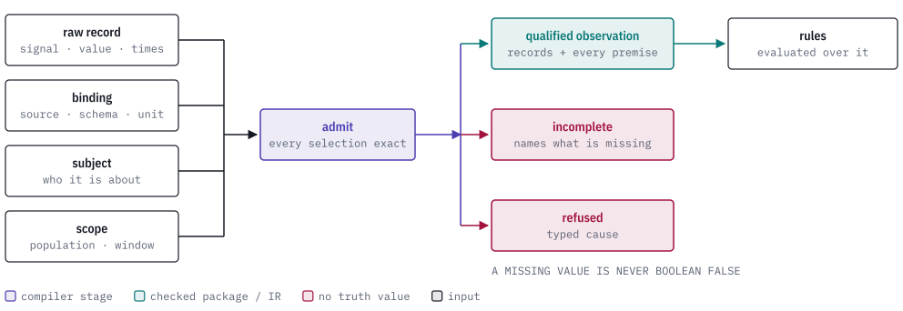
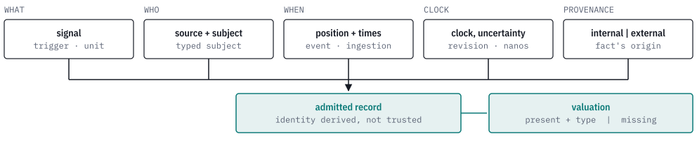

# quire-observation

[](https://discord.gg/k8DVhuYBR2)

quire-observation is a Rust library that turns a raw signal from a running
system into a qualified observation, independent of how the signal travelled.

It checks the source, schema, subject, clock, window and population that the
caller selected for each signal. The result is `Available` for a fully qualified
set, `Incomplete` when a value, member or relationship is missing, or `Refused`
with a typed cause when a selection does not match. Rule evaluators such as
quire-mltl and quire-protocol use the `Available` observation as their data.

<picture>
  <source media="(prefers-color-scheme: dark)" srcset="docs/images/hero-dark.svg">
  
</picture>

> **Status: public prerelease.** The API is still changing and the crate is not
> published (`publish = false`). Expect breaking changes.

## Records

Each candidate record names everything it depends on, and admission compares each
name with the selection the caller made. Event time and ingestion time are kept
apart. Relationships must be supplied explicitly; a timestamp does not imply one.

<picture>
  <source media="(prefers-color-scheme: dark)" srcset="docs/images/record-dark.svg">
  
</picture>

## Usage

`admit` takes one `AdmissionRequest` (the package, producer bundle, binding,
expected subject, relationships, scope, records and resource limits) and returns
an `AdmissionOutcome`. These two tests from
[`tests/admission.rs`](tests/admission.rs) show the first two outcomes; the
`request()` helper in that file builds a complete, valid request.

```rust
// A valid record is admitted and every selected premise is retained.
let outcome = admit(request());
assert!(matches!(outcome, AdmissionOutcome::Available { observation }
    if observation.records()[0].visibility == Visibility::External
        && observation.package().identity == id("package:checkout")
        && observation.limits().max_records == 2));

// The same request with no value is incomplete, not false.
let mut input = request();
input.records[0].value = ValueState::Missing;
assert!(matches!(admit(input), AdmissionOutcome::Incomplete { reasons }
    if matches!(reasons.as_slice(), [IncompleteReason::MissingValuation { .. }])));
```

## Outcomes

No outcome is a Boolean value.

| Outcome | Meaning |
| --- | --- |
| `Available` | Every required premise was admitted. The `QualifiedObservation` keeps the package, producer, binding, subject, relationships, scope, records and limits exactly as selected. |
| `Incomplete` | A required premise is absent: `MissingValuation`, `MissingMembership`, `MissingRelationship` or `MissingClosure`. |
| `Refused` | A selection is invalid or does not match. `RefusalCause` says which: a binding, subject or clock mismatch, an invalid window, an exceeded limit, a duplicate record or member, an ambiguous or conflicting relationship, or an identity that differs from the one derived by the owner contract. |

## Owner contracts

The crate also publishes fourteen canonical, bounded owner
contracts for activation scope, observation records, populations, position
ledgers, clocks, partial facts, capture environments, progress, closure,
completeness, result availability, revisioned bundles and bounded lineage. Each
has a JSON Schema in [`schemas/`](schemas/) and a module under `authority::`
whose reader returns only a strict-read, validated view. The full table of
contract names, schema digests and readers is in
[docs/owner-contracts.md](docs/owner-contracts.md).

## Limitations

The library has no telemetry adapter, temporal evaluator or protocol-result
mapper. It does not execute production monitors, interpret protocol conformance
or own an evidence store. The Producer interface 1.2 static bundle it admits
(`StaticProducerBundle`, `AdmittedStaticBundle` in `src/producer.rs`) is
validated by this crate's own code, and a test fixture of that shape lives in
[`tests/fixtures/`](tests/fixtures/).

## Quire ecosystem

<picture>
  <source media="(prefers-color-scheme: dark)" srcset="docs/images/ecosystem-dark.svg">
  
</picture>

quire-observation depends on
[quire-canonical](https://github.com/agent-ix/quire-canonical) for canonical JSON
and on no other Quire repository. Temporal and protocol checks build on it:
[quire-mltl](https://github.com/agent-ix/quire-mltl) and quire-protocol
(private) both depend on this crate and take an `Available` observation as the
data a rule is evaluated over.

## Building and testing

The repository gate, from [AGENTS.md](AGENTS.md):

```sh
cargo fmt --check
cargo clippy --locked --all-targets -- -D warnings
cargo test --locked
RUSTDOCFLAGS="-D warnings" cargo doc --locked --no-deps
```

Hosted CI runs only when dispatched by hand, so run the gate locally before
opening a pull request. The requirements, test cases and reviews are Markdown
files under [`spec/`](spec/) and [`reviews/`](reviews/); tests are tagged with
the criteria they check.

## Contributing and license

Contributions need the [CLA](CLA.md); see [CONTRIBUTING.md](CONTRIBUTING.md) and
[AGENTS.md](AGENTS.md). Questions are welcome on
[Discord](https://discord.gg/k8DVhuYBR2). Licensed under
[AGPL-3.0-or-later](LICENSE); see [LICENSE-DECISION.md](LICENSE-DECISION.md).
